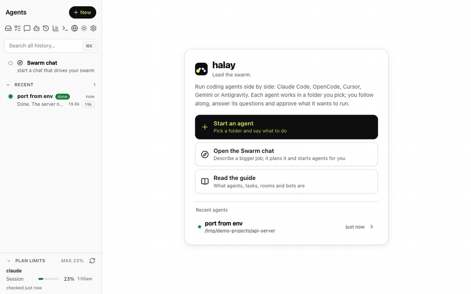
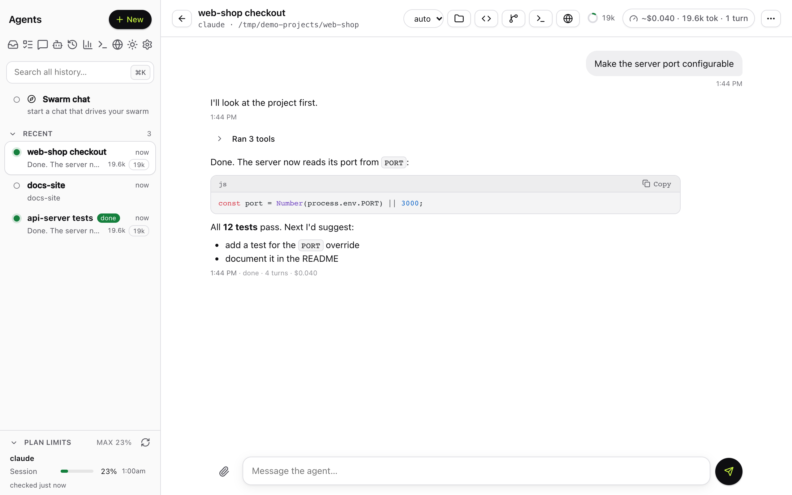
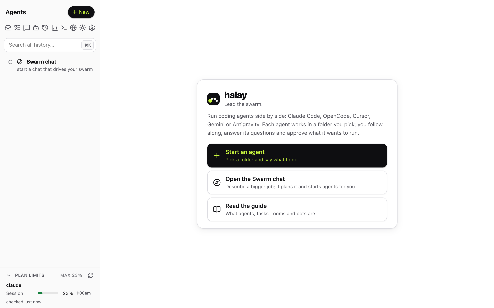
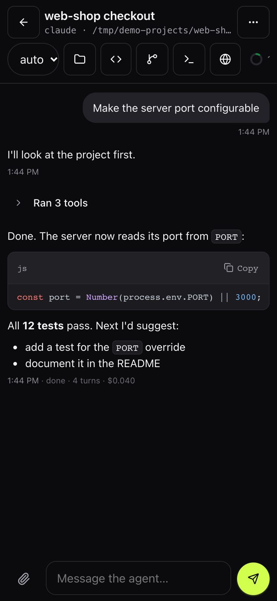
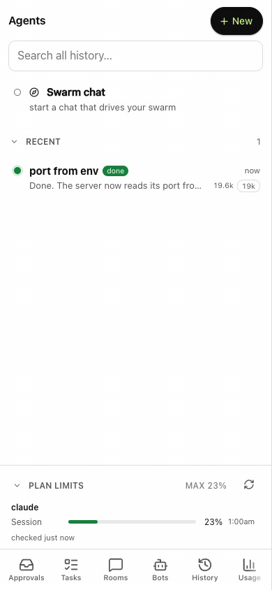
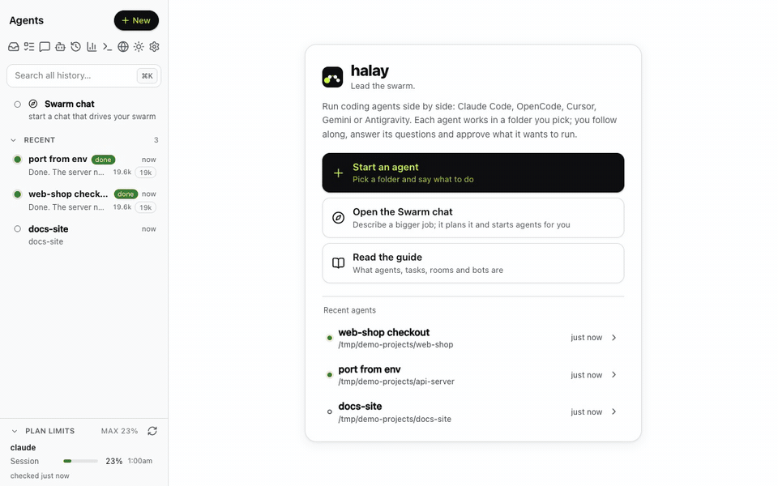
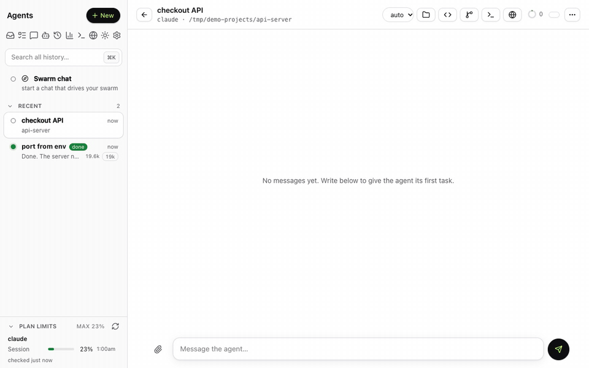

<h1> halay</h1>

**Lead the swarm.** A self-hosted web UI to run and control coding agents, one per folder: [Claude Code](https://www.anthropic.com/claude-code), [OpenCode](https://opencode.ai), [Cursor's agent CLI](https://cursor.com/cli), [Gemini CLI](https://github.com/google-gemini/gemini-cli) and [Google's Antigravity CLI](https://antigravity.google/cli). Chat with several agents at once from your desktop or phone, approve their tool calls, queue tasks, let agents start and message each other, and watch the whole swarm in one place. It is a local Node server that drives the agent CLIs you have installed; nothing is sent anywhere except by those CLIs themselves.

> **Not affiliated with any of these vendors.** This is an independent, unofficial project. It is not affiliated with, endorsed by or sponsored by Anthropic, PBC, Anysphere (Cursor), Google or the makers of OpenCode. "Claude" and "Claude Code" are trademarks of Anthropic, "Cursor" is a trademark of Anysphere, "Gemini", "Antigravity" and "Google" are trademarks of Google, and "OpenCode" belongs to its owners. See [Disclaimer](#disclaimer).

## Requirements

- **Node.js 22 or newer** (24 or 26 recommended).
- **macOS or Linux.** Windows is not supported (WSL may work but is untested).
- **At least one agent CLI**, installed by you and on the server's `PATH`. They are other people's software; this project includes none of them, and your use of each is governed by its vendor's terms and your own plan or API account. Claude Code is the reference: it is always offered. The others show up as soon as their CLI is found (and, for Cursor and Antigravity, new enough to have its ACP mode). `HALAY_BACKENDS=claude,opencode` limits which are offered.
  - **Claude Code** (`claude`): log in once in a terminal (or per account in Settings → Accounts).
  - **OpenCode** (`opencode`): its free models need no login. For other providers run `opencode auth login`.
  - **Cursor** (`cursor-agent`, newer builds; `cursor-agent update` if the swarm says it is too old): `cursor-agent login`, or set `CURSOR_API_KEY`.
  - **Gemini CLI** (`gemini`): run `gemini` once and log in with Google, or set `GEMINI_API_KEY` (or use Vertex AI). Google retired Gemini CLI for personal Google accounts on 2026-06-18; for a personal account use Antigravity (below).
  - **Antigravity** (`agy`, [antigravity.google/cli](https://antigravity.google/cli); `agy update` if the swarm says it is too old): run `agy` once and sign in with Google.
- git. Optional: zsh (only for accounts defined as shell aliases), Chromium (agent browser, `npx playwright install chromium`), Tailscale (HTTPS and phone access).

## Quick start

    npm install -g @halay/app
    halay            # prints http://localhost:4777/?token=...

To keep it running in the background (starts at login): `halay service install` (launchd on macOS, systemd on Linux).

Just trying it? `npx @halay/app` runs it without installing. Your data in `~/.halay` (agents, token, settings) carries over if you install it later; the service needs the real install, so `halay service install` refuses to run from npx.

`halay token` prints the sign-in URL again, `halay restart` / `halay stop` control a running server, `halay cert install` adds HTTPS on the LAN with a CA of its own (for phones without Tailscale), `halay --help` lists the rest. Data (token, database, agents' files) goes in `~/.halay`.

From a git clone instead (to contribute, or to run unreleased code): `git clone https://github.com/halayhq/halay.git && cd halay && npm install && npm start`.

Open that URL and **Set up your passkey** (first run only; the token proves it's you), then click **+ New**, pick a folder (and, when more than one CLI is installed, the **Agent CLI**), and chat with the agent.

### Mac app

On a Mac, `halay app` opens a small native menu-bar app (macOS 13+, Apple silicon and Intel, about 0.8 MB). It is only a shell: the server stays the Node server you already run, and the app shows its status and opens the web UI in a window of its own.

- **Status in the menu bar**: whether the server is reachable, and how many agents are running or blocked (the icon shows the number of blocked agents).
- **Already signed in**: the window opens without a passkey prompt (a local sign-in with a private token file the server writes at every start; loopback only, `HALAY_LOCAL_APP=0` turns it off).
- **macOS notifications** for agents that are done, failed or need approval, also while the window is closed or was never opened.
- **Native window**: unified title bar; a Dock icon and a menu bar (File, Edit, View, Window) only while the window is open. Closing it leaves the menu-bar icon.
- **Settings** (⌘,): this Mac (found automatically) or another server's http(s) address, the data folder, Test Connection, and **Launch at Login**.
- `halay app install` copies it to `~/Applications` (Spotlight finds it). Run it again after updating halay. In a git clone, build it first with `macos/build.sh`.

Limits: macOS only; ad-hoc signed and not notarized (files npm installs aren't quarantined, so macOS doesn't ask; a copy downloaded with a browser would be blocked); not on the App Store; no Homebrew cask yet. A server on another machine has no automatic sign-in: sign in once in the window, and use https off the local network. Details: [docs/install.md](docs/install.md#mac-app), [macos/README.md](macos/README.md).

Full setup (prerequisites, `.env`, accounts, phone/HTTPS access, running as a service): [docs/install.md](docs/install.md). Settings are environment variables or a `.env` file; see [.env.example](.env.example).

## Agent CLIs: what differs

An agent runs on one CLI, chosen through its account (each account belongs to one CLI). Claude Code speaks its own stream-json protocol; OpenCode, Cursor, Gemini CLI and Antigravity are driven over [ACP](https://agentclientprotocol.com) (`src/backends/*.js`). Most of the swarm is the same on all of them: chat and tool cards, approval cards, interrupts, resuming sessions, worktrees, tasks, schedules, rooms, bots, the conductor, the swarm and browser MCP tools, fresh context with handoff, watchdogs and surviving server restarts. The differences, from what each backend declares:

- **Permission modes.** Claude: `auto`, `manual`, `acceptEdits`, `plan`, `bypassPermissions` and `cli` (the CLI's own settings decide). The others have no `auto`; an inherited or default `auto` becomes `manual` for them. On ACP CLIs the swarm applies the mode itself to the CLI's permission requests. There `acceptEdits` auto-allows only edits whose paths are inside the agent's folder or temp folder; the rest asks.
- **Plan approval.** Claude, OpenCode, Cursor and Gemini show the same plan card; Antigravity has no plan mode. Claude uses its own, Cursor and Gemini send theirs, and OpenCode gets the swarm's `submit_plan` tool, which switches it out of plan mode once you approve.
- **Questions.** Claude's own question tool works. The others get the swarm's `ask_user` tool, shown as the same question card.
- **Input while the agent is working.** Only Claude takes a message mid-turn. The others queue it and send it when the turn ends.
- **Lean mode** (only the swarm's MCP server loads): Claude and Gemini. Not OpenCode, Cursor or Antigravity.
- **Models.** Claude: aliases (`opus`, `sonnet`, ...) or full ids. OpenCode: `provider/model`, listed from `opencode models`. Gemini: any model id you type. Cursor: model names listed from its ACP server. Antigravity: the ids a session offers (`gemini-3.8-flash-high`, ...; only the three Gemini ones on a free account). Settings → Agent defaults has a block per CLI (permission mode, model, effort), so each CLI gets its own defaults; until you set them the other CLIs start in `manual` on their own default model.
- **Effort.** Claude (`low` to `max`) and Cursor (set as the model's own effort option). OpenCode and Gemini have none, and Antigravity's is part of the model id (`-low`, `-medium`, `-high`).
- **System prompt.** Claude, OpenCode and Antigravity take the swarm's instructions as an appended prompt or instructions file. Cursor and Gemini can't, so the instructions go in front of each session's first message.
- **Usage.** Tokens and cost: Claude and OpenCode. Gemini and Antigravity: tokens, no cost. Cursor reports neither. Plan limits, Remote Control, the auto-compact window and subagent transcripts are Claude-only.
- **History.** Claude, OpenCode and Cursor sessions are listed (the latter two through ACP `session/list`); Gemini's and Antigravity's are not.
- **Cursor and its default model.** cursor-agent saves every model change as your default in its `cli-config.json`. To keep that from changing your Cursor setup, each Cursor agent runs with a config folder of its own under its temp folder: a copy of your `cli-config.json` (your permissions included) and links to everything else. Model changes go into that copy and are removed with the agent. Cursor also keeps its login in the macOS keychain, one per user, so there is no second Cursor account.
- **Built-in subagents** are off by default on every CLI (Settings → Agent defaults) so agents delegate through swarm agents. Claude, OpenCode and Gemini can turn theirs off; Cursor and Antigravity can't and are only told.
- **Antigravity (`agy acp`)**, what to know:
  - Approvals: its shell commands and file edits ask, and the permission mode applies as for the other ACP CLIs (`acceptEdits` allows edits inside the agent's folder). Its MCP calls (the swarm's own tools and any other MCP server's) and reads never ask, and no setting makes them: `agy acp` takes no `--settings`, and its ACP server ignores `permissions` rules in settings files. So `manual` cannot gate an MCP server's tools for it. It also doesn't ask for edits in a folder under the server process's temp folder (the agent's own temp folder is one).
  - It only offers Allow and Deny, no "always": the swarm remembers your "Always allow" for the agent's current process (a command's leading words, e.g. `git status`, with plain arguments only) and asks again once that process restarts.
  - No plan mode (it has no `session/set_mode`) and no effort setting.
  - No second account: its login is in the OS keyring, one per user, and `GEMINI_CLI_HOME` doesn't isolate it. Sign in once with `agy`.
  - Over ACP only the three `gemini-3.8-flash-*` ids were offered on a free account; the Claude and GPT-OSS ids `agy models` prints were refused. A free account's quota is limited.
  - Usage is tokens per turn; there is no cost and no context gauge. Its own subagent tools can't be turned off. `agy` keeps its sessions and a cache of MCP tool schemas under `~/.gemini/antigravity-cli/`.

Gemini CLI has not been run against a real login yet; it is tested against a fake ACP agent only.

## Security model (short version)

This app gives whoever can sign in a shell on your machine: agents run commands as the server's user and there is a web terminal. It listens on `127.0.0.1` by default. Do not expose it to the public internet; for remote or phone access use a private network with HTTPS (e.g. `tailscale serve`). Browsers sign in with passkeys, agents and the API use a secret token (`.token`, mode 600). Read [SECURITY.md](SECURITY.md) before changing `HOST`.

## Plugins

Add-ons can add agent tools, notification channels, API routes and UI blocks; ntfy and webhook notifications ship as built-in plugins. See [docs/plugin-authoring.md](docs/plugin-authoring.md) for writing one. Start with `HALAY_PLUGINS=0` for safe mode.

## Features and reference

- `npm run dev` restarts the server when `src/server.js` changes and reloads open browser tabs when `public/` changes. Agents are saved, so a restart only stops their processes; the next message resumes them. The UI resyncs itself after a restart.
- Each agent is a process of its CLI in the chosen folder (for Claude Code `claude -p --input-format stream-json`, for the others their ACP server); stopped agents resume their session on the next message.
- UI: light / dark / system theme (Settings → Appearance, or Theme in the sidebar's More menu). ⌘K / Ctrl+K opens a quick switcher over agents, folders, past sessions and messages; `/` focuses search, `g t` / `g h` open Tasks / History. Claude's background subagents show live progress on their card, and **Details** opens their transcript (`GET /api/agents/:id/subagent/:taskId`).
- Data: everything written at runtime (`.token`, `halay.db`, `runs/`, `tmp/`, `bots/`, plugins, logs) lives in one data folder, `~/.halay` by default (`HALAY_HOME` moves it; a git checkout that already holds data keeps using itself). The startup log and Settings → Server show which. Details: [docs/install.md](docs/install.md#data-folder).
- Configuration: environment variables, or a `.env` file in the data folder (a clone's own `.env` is read too; see `.env.example` for the list). Variables set in the environment override `.env`.
- For phone access: `HOST=0.0.0.0 npm start` and open the URL over Tailscale/LAN. The UI signs in with passkeys (use the HTTPS address, see below) and the token is still the machine credential (a browser login only until the first passkey exists); with the web terminal either gives a shell on the machine, so don't expose it to the internet.
- Agents survive server restarts: each agent's CLI process runs detached (stdin is a FIFO, output goes to a file under `runs/`). A restarted server reattaches, catches up on what the agent did meanwhile, and shows it running or idle. Stopping the server leaves agents running; `HALAY_KILL_AGENTS=1` stops them too. An approval that was waiting during a restart is marked expired; Claude re-asks it, and for the ACP CLIs the swarm raises it again from the request they are still waiting on.
- Agents and their history are saved in `halay.db` (SQLite). After a restart they show as stopped; the next message resumes the CLI's session.
- Claude agents can run "as in the CLI" (mode `cli`): no `--permission-mode` is passed, so your Claude settings decide, same as a terminal session; other CLIs have the same `cli` mode with their own settings. "Always allow" saves a rule to the project's `.claude/settings.local.json` for Claude, like the CLI's "don't ask again"; on the other CLIs it uses the CLI's own "allow always" option. The default for new agents from the UI is `auto` for Claude and `manual` for the other CLIs, until you change it per CLI in Settings → Agent defaults.
- Per-agent **Remote** button (Claude Code only) runs `claude remote-control` in the folder so it also appears in claude.ai/code and the mobile app (separate session; the folder must already be trusted by running `claude` there once).
- Permission approvals appear in the chat as Allow / Always allow / Deny cards. For Claude Code they arrive through `--permission-prompt-tool` (see `src/swarm-mcp.js`); for the other CLIs through ACP permission requests, which the swarm answers after applying the agent's permission mode (see [SECURITY.md](SECURITY.md)).
- Questions: on the other CLIs the swarm's `ask_user` tool takes the place of the tool they lack and shows the same card. Claude Code's `AskUserQuestion` tool reaches the same permission prompt (in every mode, `auto` and `bypassPermissions` included, since it needs a person), but a plain Allow would hand the agent "The user did not answer the questions." So it gets its own card instead: each question with its header, options (label and description; checkboxes for multi-select) and an **Other…** text field, then **Submit answers** or **Decline**. The answers go back as the allowed call's `updatedInput` = `{ ...input, answers: { [question text]: answer } }`, a multi-select answer being its labels joined by `, ` (as the CLI does; a label with `, ` in it is JSON-quoted), and Decline denies with "The user declined to answer the questions." API: `POST /api/agents/:id/permission` or `/api/approvals/:reqId` with `{ decision: 'answer', answers }` (an array in question order or an object keyed by question text; each a string or, for multi-select, an array) or `{ decision: 'deny' }`; `allow`/`always` are refused for a question. The agent list, bots, rooms, toasts and push say **has a question** rather than needs approval; `list_agents`, `read_agent`, `wait_for_agent` and `list_rooms` tell the conductor the agent is blocked on a question for the user (agent summaries carry `waiting: { questions, approvals }`). Test: `test/questions-e2e.mjs`.
- Resuming a session also imports its earlier messages into the chat. Set `HALAY_DB` to use a different database file (handy for testing).
- The new-agent dialog lists earlier sessions for the chosen folder and account: Claude's (read from its own transcripts, so terminal sessions appear too), and OpenCode's and Cursor's (asked from the CLI; Antigravity's are not listed); pick one to resume it.
- Accounts are added in Settings → Accounts: choose a CLI and a name (and optionally a folder); each account gets a folder of its own for its login, through the CLI's own variable (`CLAUDE_CONFIG_DIR`, `XDG_DATA_HOME` for OpenCode, `GEMINI_CLI_HOME` for Gemini; Cursor and Antigravity can't, their login is in the keychain or keyring), and a terminal then logs it in. They work at once, with no shell alias and no restart. Accounts defined as zsh aliases (e.g. `alias claude-work='CLAUDE_CONFIG_DIR=… claude'`, read at server start) still work, and **Keep here** stores one in the swarm so the alias can go. Every installed CLI also has its own default account (`claude`, `opencode`, `gemini`, `cursor`, `antigravity`); **Set as default** makes another account the one its CLI's agents, tasks and schedules get when none is picked. Settings → Accounts shows each account's login state (Claude: `claude auth status`; Cursor: `cursor-agent status`; OpenCode: `opencode auth list`, its free models need no login; Gemini: an API key, Vertex setting or its OAuth file; Antigravity: `agy models`) with an Open terminal button that runs the login command, and an agent that fails on authentication says so in its chat and notifies you. Step by step: [docs/accounts.md](docs/accounts.md).

## Screenshots

 

On a phone (the installable web app, 390px):

Colour themes, light and dark (Settings → Appearance):

More in [docs/screenshots/](docs/screenshots/) (all taken from a throwaway instance with demo agents and a scripted stand-in for the agent CLI, never a real agent: `bin/make-screenshots.mjs` for the stills, `bin/make-demos.mjs` for the animations, each GIF with an MP4 next to it). Colours, icons and how to change the accent: [docs/theming.md](docs/theming.md).

## Login

- Browser login uses **passkeys** (WebAuthn via `@simplewebauthn`, `src/auth.js`). With none registered the login page offers **Set up your passkey**, which requires the access token (the `?token=…` URL printed at startup), so nobody else who can reach the page can claim the account. Further passkeys are added, renamed and removed in **⚙ Settings → Security** (needs a signed-in browser), where **Log out** is too. One user for now; the tables (`users`, `passkeys`, `sessions`) are keyed by user.
- A login is a 30-day `halay_session` cookie (HttpOnly, `SameSite=Lax`, `Secure` over https) backed by the `sessions` table (hashed, with expiry). The UI, API, uploads, WebSockets and the terminal accept the session or the token; unauthenticated browsers only get the login page. Agents and `src/swarm-mcp.js` keep sending `Authorization: Bearer <token>` (or `?token=`), unchanged.
- The [Mac app](#mac-app) signs in without a passkey: the server writes a random `local-app-token` (mode 600) at every start and accepts it at `POST /auth/local` only from a direct loopback connection (no forwarding headers), answering with a normal session cookie. `HALAY_LOCAL_APP=0` turns it off.
- The token signs a browser in only while no passkey exists (first run); after that browsers need a passkey, and the token stays for scripts and the API (agents get a token of their own that opens only the swarm tools). Lost every passkey? `HALAY_RESET_PASSKEYS=1` (for one start) clears all passkeys and sessions. Failed attempts are rate limited. Passkeys need https or localhost and belong to the address they were made at (derived from `HALAY_PUBLIC_URL`/Settings or the request host), so on a phone use the `tailscale serve` HTTPS address. Details: [docs/install.md](docs/install.md#login-passkeys). `test/auth-e2e.mjs` is the end-to-end check (Playwright + a virtual authenticator, run against a spare instance).

## Swarm MCP (agents starting agents)

Every agent gets the `swarm` MCP server (`src/swarm-mcp.js`) with tools `start_agent`, `list_agents`, `send_message`, `read_agent`, `wait_for_agent`, `interrupt_agent`, `remove_agent` and `refresh_agent_context`, so an agent can start other agents in the swarm, hand them tasks, collect results and remove them when done, plus the schedule tools (`list_schedules`, `add_schedule`, `update_schedule`, `delete_schedule`, `run_schedule_now`; see Schedules below). `remove_agent` goes through the same path as the UI's Remove button (`DELETE /api/agents/:id`): a running agent is stopped first, and an agent whose worktree has uncommitted files or whose one-off folder still has files is not removed; the tool says so and the user has to remove it from the UI. The children show up in the sidebar (marked with the agent that started them) and use the same approval cards. An agent can only see and control agents it started. A child inherits its parent's folder, account, permission mode, model and effort (unless `start_agent` overrides them) and can't be more permissive than its parent, nor can a schedule an agent adds or an agent it starts on a peer be more permissive than that agent. Each agent's swarm MCP server has a token of its own that opens only these tools, not the rest of the API. Limits: 3 levels deep, 8 children per agent, 20 running agents.

## Swarm chat (the conductor)

The pinned **🧭 Swarm chat** entry is a normal agent with a system prompt (`prompts/conductor.md`, editable with the **Prompt** button) and a wider view of the swarm: it can list and drive every agent, list accounts (it picks the CLI by the account it names) and earlier Claude sessions, and start agents in any folder (`start_agent` with an absolute `cwd`, optionally `session_id` to continue an old session). Agents it starts are shown under it. It still can't start an agent with more permissive settings than its own. It can run on any CLI (switch its account on the Swarm chat); on a CLI without Claude's `auto` mode it runs in `acceptEdits`, and it never has built-in subagents. Its prompt is told each CLI's model naming.

**New context** (on every agent, not just the swarm chat) kills the process and clears the session id, so the next message starts a fresh session; the old chat stays on screen above a divider. A prompt edit applies from the next new context. The swarm's own tools are pre-allowed (Claude: `--allowedTools`; the other CLIs: the swarm answers their permission request itself) so they don't ask for approval each time.

## Todos, notifications, approvals, temp folders

- **Todos**: each agent's live checklist (Claude's TodoWrite or TaskCreate/TaskUpdate; for the other CLIs their plan or todo updates, where they send them) shows above its chat and as counts on the list row. **Tasks** (sidebar button) is a swarm-wide backlog in SQLite: add/edit/delete/reorder, assign to an idle agent or start a new one. REST under `/api/tasks`; the conductor has `list_tasks`, `add_task`, `update_task`, `delete_task`, `assign_task`. Its **Schedules** tab holds recurring tasks (see below).
- **Notifications**: finished / error / needs-approval show as a badge on the agent row, `(n)` in the tab title, an in-page toast, and a browser Notification where the browser allows it (not over plain http). The **ntfy** plugin (**⚙ Settings → Plugins**) can also send them to an [ntfy](https://ntfy.sh) topic; it is off by default and nothing is sent until you enable and configure it.
- **Hide from recents**: long-press an agent row (about half a second; scrolling or moving cancels it) or right-click it, then choose **Hide from recents**. The agent leaves the list but is not stopped or touched; the flag is stored in the `agents.hidden` column (`POST /api/agents/:id/hidden {hidden}`) and broadcast, so it holds across devices and open tabs. A hidden agent comes back into **Needs you** by itself while it needs approval, errors or is flagged stuck, and otherwise sits under **Hidden (n)** at the bottom of the list, where the same menu says **Show in list again**. Direct links, the quick switcher and the conductor's `open_agent` still open it. The Swarm chat row can't be hidden.
- **Editor** (agent header → **Editor**): a code editor (Monaco, served locally) over the agent's folder or worktree: lazy file tree with new / rename / delete, tabs with syntax highlighting and an unsaved marker, Ctrl/Cmd+S, a diff against git HEAD, and a phone layout with the tree as a drawer. Saves are atomic and refused when the file changed on disk since it was opened (the agent edited it), with reload / compare / overwrite; open tabs without edits reload by themselves when the agent changes them. Paths can't leave the folder (`..` and outside symlinks are refused). Details: [docs/editor.md](docs/editor.md).
- **Bots**: permanent, named agents you create once in the UI (sidebar → Bots) and talk to forever, like a chat contact: a role, a home folder with `BOT.md` (its identity file on every CLI, named by path in the bot's prompt) and `memory/` (journal, notes, open threads) that the bot reads at the start and updates after every task, automatic fresh context with handoff when an idle bot passes 100k tokens, optional browser and rooms, schedules and tasks that target them, `@handle` mentions in rooms, and the conductor's `create_bot` / `list_bots` / `update_bot`. They are ordinary agents (agent list with a bot badge, approvals, notifications), default to the approval permission mode, and survive restarts. Details: [docs/bots.md](docs/bots.md).
- **Peers**: two swarms (e.g. on a Mac mini and a laptop in one tailnet) can drive each other. Settings → Peers holds each peer's address and token (stored on this server only, never shown again); the swarm chat gets `list_peers` and a `peer` parameter on `list_agents`, `start_agent`, `send_message`, `read_agent`, `wait_for_agent`, `interrupt_agent`, `list_tasks`, `get_task`, `add_task`, `assign_task`, `list_sessions` and `list_accounts` (not `update_task` / `delete_task`). Calls go through this server's `/api/peers/<name>/…` proxy, so agents never see a peer's token; what a peer starts or adds is marked `peer:<name>`. Setup and details: [docs/peers.md](docs/peers.md).
- **Rooms**: group chats where agents pass work to each other with `@mentions` (a researcher, a writer and a reviewer) without you in the middle. Sidebar → Rooms, or the conductor's `create_room`, `add_to_room`, `post_to_room`, `read_room` (members also get `post_to_room`, `read_room`, `list_rooms`, `mark_room_done`). A mention delivers the message to that agent as a turn with the room goal and recent messages (queued if it is busy); unaddressed messages are only visible in the room. Loop safety: a per-room budget of agent-triggered turns (default 20, reset by any message from you; the room pauses and you press Resume), a per-agent rate limit and no self-mentions. Details: [docs/rooms.md](docs/rooms.md).
- **Plugins** (**⚙ Settings → Plugins**): add-ons that add agent tools, notification channels (ntfy and a Slack/Discord/JSON webhook ship built in, off until enabled), API routes, event hooks, sidebar blocks and pages without forking. They come from `plugins-builtin/`, the gitignored `plugins/` folder or npm packages named `halay-plugin-*` installed into it, start disabled and are enabled with a confirm that lists their permissions. They run inside the server and the page with full access, so enable only ones you trust; errors are contained and a plugin that keeps failing is switched off; `HALAY_PLUGINS=0` starts with all of them off. The Machines sidebar block is a built-in plugin. Writing one: [docs/plugin-authoring.md](docs/plugin-authoring.md); test: `test/plugins-e2e.mjs`.
- **Approvals**: the sidebar's Approvals button lists every pending permission request across agents with Allow / Always allow / Deny (`/api/approvals`), and agents' questions (`kind: 'question'`) as answerable question cards.
- **Temp folders**: every agent gets `tmp/<agent-id>/` in the data folder ( `TMPDIR`/`TMP`/`TEMP`, mentioned in its system prompt); removed when the agent is removed.

### Web Push (notifications with the page closed)

Browsers only allow notifications and service workers on HTTPS, so serve the app through Tailscale (the app itself stays plain http on 4777):
`tailscale serve --bg --https=443 http://127.0.0.1:4777` (the macOS app needs `TAILSCALE_BE_CLI=1 /Applications/Tailscale.app/Contents/MacOS/Tailscale serve …`, and Serve must be enabled for the tailnet), then put that address in `.env` as `HALAY_PUBLIC_URL=https://<machine>.<tailnet>.ts.net` (copy `.env.example`), open `https://<machine>.<tailnet>.ts.net/?token=…` and go to **⚙ Settings → Enable notifications**. On iPhone, first Share → Add to Home Screen and enable it from the Home Screen app. VAPID keys are generated once into the `settings` table; subscriptions live in `push_subs`. The HTTPS address (also used as the VAPID subject) comes from Settings, else `HALAY_PUBLIC_URL`; with neither set a placeholder `mailto:` subject is used. ntfy stays as an optional, off-by-default fallback.

## Git / worktrees, task dependencies, schedules, usage, search, watchdogs

- **Git view** (agent header → **Git**): branch, ahead/behind (upstream, and base for worktrees), dirty counts, diff stat, a capped read-only diff (tap a changed file for just its diff), recent commits, for the agent's folder and any repo/worktree under `tmp/<agent-id>/`. **New agent → "Start in a new git worktree"** runs `git worktree add -b swarm/<id> tmp/<id>/wt` off the repo's current branch and starts the agent there (the MCP `start_agent` has `worktree: true`). **Review and merge…** shows commits, stat, full diff and a dry-run conflict check against the base, then merges (fast-forward or merge commit) into the base repo's checkout after an explicit confirmation, optionally removing the worktree and branch. It never pushes or forces: merging is refused if the agent is working, the worktree has uncommitted/untracked files, the branch moved since review, or the base checkout is on another branch / has tracked changes; worktree removal uses plain `git worktree remove` and `branch -d`. Removing an agent whose worktree has uncommitted files asks for a second confirmation; its branch is always kept. REST: `/api/agents/:id/git[/diff|/review|/merge|/remove]`, `/api/git/probe?path=`; paths must be inside the agent's folder or its tmp dir (`src/git-tools.js`, `execFile` only).
- **Task dependencies**: a task can depend on other tasks (`dependsOn`). A queued task is `ready`, `waiting` or `blocked` (a dependency failed, is blocked, or was deleted; blocked tasks never start). `{{result:<id>}}` in a prompt is replaced by that task's result when it starts (and counts as a dependency). Loops are rejected. **Auto-start** (per task, off by default) starts a ready task when its last dependency finishes: a new agent in its folder, or the agent that just finished if it has none. A task whose agent process dies is marked failed. MCP: `add_task`/`update_task` take `depends_on`, `auto_start`; `get_task` returns a full result.
- **Schedules** (Tasks → **Schedules** tab): recurring tasks on a 5-field cron (with presets) in a chosen IANA time zone (default the server's), stored in the `schedules` table. Each run creates a new task (`scheduled_from` = the schedule; title, prompt, folder and account copied) and starts a new agent for it through `assignTask`, in the schedule's folder or a fresh one-off scratch folder; it is never an earlier run's agent. The task ends done/failed with the agent's result like any other. In the prompt, `{{last_result}}` and `{{last_run_at}}` become the previous run's result and time (empty / "never" on the first run), alongside `{{result:<id>}}`. A 30 s ticker runs due schedules: if the previous run is still going, `overlap: skip` skips that run and `queue` starts it when the previous one ends; when the live-agent limit (`HALAY_MAX_LIVE`, default 60) is reached it retries on the next tick; when the account is past its daily usage threshold (Settings → Usage warnings) the run is skipped, the reason shown on the schedule and a notification sent. `next_run_at` is persisted and always computed from now (`croner`), so runs missed while the server was down become a single run at startup. After a run, `notify` decides about a push (`always`, `failure`, or `alert` = only when the result contains `ALERT:`; Settings → "Include details" adds the text), instead of the usual per-agent "finished" push, and idle run agents beyond the newest `keep_agents` (default 3) are removed through the normal removal path (one-off conversations stay in History; running agents and ones waiting for approval are never removed). The newest 100 runs are kept as run history. **Run now** runs once without moving the next run. REST: `/api/schedules` (GET, POST), `/api/schedules/:id` (GET with `runs`, PATCH, DELETE), `POST /api/schedules/:id/run`, `GET /api/schedules/preview?cron=&tz=` (description and next runs, or a clear error); changes are broadcast as `{type:'schedules'}`. MCP (every agent): `list_schedules`, `add_schedule`, `update_schedule`, `delete_schedule`, `run_schedule_now`. The agent that added a schedule is stored in `created_by` (`createdBy` in the API; NULL = added in the UI). A regular agent sees every schedule but can only update, delete or run the ones it added: src/swarm-mcp.js sends the caller in an `x-halay-agent` header and the server answers 403 otherwise. The conductor and the UI can change any schedule.
- **Usage**: each finished turn is stored in the `usage` table (tokens in/out, cache read/write, cost). Cost is what the CLI reports: Claude Code's `total_cost_usd` (cumulative per process, stored as per-turn deltas) or OpenCode's cost; it is an API-price estimate, not a bill, and turns without one show as unavailable (Gemini reports tokens only, Cursor neither). Per-agent totals show above the chat; **Usage** (sidebar) groups by account and day. Existing history was backfilled once without dates ("earlier"). **Settings → Usage warnings** sets a daily cost and/or token threshold per account; crossing it raises one notification per day.
- **Plan limits** (bottom of the sidebar, Claude accounts only): each account's session and weekly limits as Claude Code's `/usage` shows them. The server runs `claude -p /usage --output-format json --no-session-persistence` with the account's environment (answered locally, no model turn), once per config dir, so aliases on the same login share one reading. Results are cached for 5 minutes; the page re-checks every 5 minutes while visible, and ↻ forces a fresh check. REST: `GET /api/limits[?refresh]` returns `{account: {at, limits: [{label, pct, resets}], note, error}}`.
- **History** (sidebar → More): every past session in any folder, grouped by working directory (newest activity first, collapsible, state kept in the browser; **Hide** forgets a folder client-side). Rows show first prompt, last activity, turns, model and tokens (summed from the transcript; cost only for sessions that are live swarm agents). A live session shows a green badge and opens that agent instead of starting a duplicate; **＋ New** starts a fresh agent in the folder. Transcript stats are scanned incrementally (only newly appended bytes) and cached in the `session_stats` table, so opening is fast even with huge transcripts; the first run after install indexes in the background. Sessions of OpenCode and Cursor are listed too, by the CLIs themselves (ACP `session/list`, refreshed every 30 s while History is open), labelled with their CLI; resuming one reads its conversation into the chat and continues it on that CLI with one of its accounts. Gemini CLI can't list its sessions over ACP yet.
- **Search**: the sidebar search box queries an FTS5 index over event history (prompts, replies, tool calls/results, errors); results show agent, time and a snippet and open the agent at the nearest match. Events recorded before timestamps existed show "earlier (undated)".
- **Watchdogs** (on by default, **Settings → Watchdogs**): an agent that is `running` with no events for N minutes (default 15, not counting a wait on an approval), or that repeats the same tool call with the same input 4+ times in a row, gets a `stuck?`/`looping?` badge, a banner with a one-tap **Interrupt**, and one notification per incident. It never interrupts by itself.

## Model, effort and agent defaults (saving usage)

Every agent runs on a model and an effort level; unset means the CLI's own default. For Claude Code the model is `--model` (an alias such as `opus`, `sonnet`, `haiku`, `fable`, or a full model id) and the effort `--effort low|medium|high|xhigh|max`. Other CLIs take their own model names (OpenCode `provider/model`, Gemini a model id, Cursor a model name; the picker lists them where the CLI can) and only Cursor has an effort setting; see [Agent CLIs](#agent-clis-what-differs). Both can be picked wherever an agent is started: **New agent → Options**, the task and schedule forms, the bot form, `start_agent` / `add_task` / `update_task` / `assign_task` / `add_schedule` / `update_schedule` / `create_bot` / `update_bot` (MCP), and `model` / `effort` on `POST /api/agents`, `/api/tasks`, `/api/schedules`, `/api/bots`. Precedence: the request (or the task's / schedule's stored value), else the parent agent's, else **Settings → Agent defaults** (the block of the agent's CLI), else the CLI default. A parent's model, effort and mode are inherited only by a child on the same CLI. A task aimed at an existing agent or a bot keeps that agent's model. A request for a mode, model or effort the CLI doesn't have is refused. An idle agent's model and effort can be changed from its chat header menu (⋯ → Model / Effort) or `POST /api/agents/:id/model { model, effort }` (`''` = default); like a mode change it restarts the process, which resumes the session, so it applies from the next message (bots: on the Bots page). The model and effort show in the chat header, the agent list and `list_agents`. **Settings → Agent defaults** (`GET/PUT /api/settings/agents`) also sets the permission mode new agents get from the UI, tasks and schedules (default `auto` for Claude, `manual` for the other CLIs, set per CLI; `GET/PUT /api/settings/agents` carries the other CLIs' as `perBackend: { <cli>: { permissionMode, model, effort } }`); agents started by agents still inherit their parent's mode and can't be more permissive. The conductor is told to pick the cheapest model that can do a job (haiku/sonnet with low effort for lookups, routine checks and scheduled jobs; opus for hard work). The agent list also shows each agent's total tokens (input + output + cache), and the header usage chip the same total, to spot expensive agents. Test without model calls (fake CLI on PATH, spare instance): see the header of `test/models-e2e.mjs`.

## Context size

An agent's whole context is re-sent on every turn, so long-lived agents get slow and expensive. Measured on this machine (Claude Code 2.1.304): a fresh agent's first API call is about 18k tokens (Sonnet) to 19.4k (Opus), and claude.ai connectors add about 1.7–2.1k once they load.

- **Gauge** (Claude, OpenCode and Gemini; Cursor and Antigravity report no context size): each agent's current context size (for Claude, the last main-thread API call's input + cache read + cache write, since `result` usage sums a whole turn and is not the context; OpenCode and Gemini report their own used size) shows in the list and chat header, amber from the warn threshold and red from the high one (defaults 100k / 150k). It is in the agent summary as `context`, resets on a new context, follows compaction (`compact_boundary`), and is recomputed from the event history on restart. Crossing the high threshold sends one notification per session.
- **Fresh context + handoff** (chat header; `POST /api/agents/:id/refresh {message?, wait?}`; MCP `refresh_agent_context`): the idle agent writes a 300–500-word handoff note (goal, state, decisions, open threads, key files, next steps), then its session is reset and the note, labelled as a handoff, goes in front of the next message (or right away with `message`). Messages sent while the note is being written wait for the new session. A worktree with uncommitted files is named in the note. **New context** still resets without a note.
- **Automatic recycling** (**Settings → Context**): idle agents over N tokens and idle M hours get a fresh context with handoff (off by default; 150k / 2h). The conductor has its own setting, on by default (60k / 3h idle). Running agents, agents waiting for an approval and stopped agents (except the conductor) are never touched.
- **Auto-compact window** (Claude only): passed to agents as `CLAUDE_CODE_AUTO_COMPACT_WINDOW` (Claude Code accepts 100,000–1,000,000 tokens and compacts a bit before it, about 88k at 100,000). Empty = the CLI default. Applies when an agent's process next starts.
- **Lean mode** (Claude and Gemini): per agent (new-agent dialog, `lean: true` on `POST /api/agents` / `start_agent`) or as the default in Settings: launches with `--strict-mcp-config` (Gemini: `--allowed-mcp-server-names`), so only the swarm MCP server (and the browser, if on) loads, none of your MCP servers or claude.ai connectors.
- Every agent's appended system prompt asks it to hand real work (edits, long or parallel jobs, other folders, anything the user may want to follow) to swarm agents with `start_agent` rather than the CLI's built-in subagent tool (Claude Code's Agent tool); the `start_agent` tool description says the same, since Claude Code's own prompt favours its built-in subagents and long sessions drift to them. By default built-in subagents are off altogether (Settings → Agent defaults → Built-in subagents): every agent then runs with `--disallowedTools Agent,Task` (OpenCode: `permission.task: deny`; Gemini: a system settings file with `experimental.enableAgents: false`; Cursor can't turn its own off and is only told), so it can only delegate through the swarm, where you see, message and continue every agent. Turned on, built-in subagents stay for quick read-only lookups. The swarm chat never has them. The prompt also asks agents to read files in parts, filter big command output and keep answers short. The swarm MCP tools return clipped output (`read_agent full=true` / `result=true` for more). The instructions are put together per CLI in `src/prompts.js`: agents on other CLIs get the same text in their CLI's terms, with the swarm's `ask_user` and `submit_plan` tools where their CLI has no question or plan approval of its own.

## Browser for agents

Agents can get a real Chromium with persistent logins on web admin panels (Hetzner, AWS, registrars, …), and you can watch it live and take over, on the desktop or the phone. It is [Microsoft's Playwright MCP](https://github.com/microsoft/playwright-mcp) attached as a `browser` MCP server, opt-in per agent (**New agent → Options → Browser**, `browser: true` / `browser_profile` on `start_agent` and `POST /api/agents`) with a default in **Settings → Browser**, so lean agents stay lean. Named profiles (`runs/browser-profiles/<name>/`, default `default`) keep cookies across agents and restarts; the folder holds session cookies and is as sensitive as a password manager. The agent header's **Browser** button opens the panel: live page (CDP screencast), tabs, address bar, **Take control** / **Give back** (click, scroll, type; touch-friendly), who is driving; one driver per profile (you or one agent), and agents' page actions are refused while you drive. Headless by default. Needs `npx playwright install chromium`. Details, safety notes and limits: [docs/browser.md](docs/browser.md); code in `src/browser.js` (server hooks in `src/server.js` are a few lines), `public/js/browser.js`, `test/browser-e2e.mjs`.

## Terminal

- **Terminal** (sidebar → More, or an agent's header for one in its folder): a real interactive shell, your login shell (`$SHELL -l`) in a PTY (`node-pty`), drawn with xterm.js and streamed over a WebSocket (`/ws/term`), so colours, cursor keys, Ctrl-C, resizing and full-screen programs (vim, htop) work. Several terminals open as tabs; + starts one in your home folder, an agent's button reuses its terminal or starts one in its folder. On phones a key bar adds Esc, Tab, a sticky Ctrl, ⌫ and arrows (both repeat while held), Copy, Paste and `| ~ / -`, and the terminal shrinks to stay above the keyboard. Copy shows the terminal's text (scrollback and screen) as plain text you can select with the phone's own handles, plus Copy all; Paste reads the clipboard over HTTPS, else opens a box to paste into. On iPhone/iPad the keyboard's own delete key also repeats when held (xterm's hidden input is kept non-empty, since iOS only repeats while there is something to delete).
- Closing the dialog or reloading the page only detaches: the shell keeps running and the last 256 KB of output is replayed when you come back (also from another device). The × on a tab ends the shell, as does `exit`. At most 12 terminals.
- Terminals survive server restarts, like agents: the shells live in `src/pty-host.js`, a small detached process (own session) that the server starts with the first terminal and talks to over a Unix socket (`runs/pty.sock`, mode 600, JSON lines). A restarted server reconnects, gets every terminal back with its scrollback, and the page reattaches; running programs carry on. The host exits a minute after its last terminal ends (so an updated `src/pty-host.js` takes effect then), and logs only its start/stop to `runs/pty-host.log`. `HALAY_KILL_AGENTS=1` ends the terminals with the server, like the agents. If the host is killed, its shells end and the next terminal starts a new one.
- Security: the shell runs as the server's user with full access to the machine, so a login is now as good as a shell login. REST (`GET/POST /api/terminals`, `DELETE /api/terminals/:id`) and the WebSocket upgrade both require the token or a session (401 otherwise). Keystrokes and output are never logged. `HALAY_TERMINAL=0` turns the terminal off entirely.
- **Restart server** (⚙ Settings → Server, `POST /api/server/restart`, or `swarm-restart` inside a web terminal): a detached helper waits for the server to exit and starts it again, so a restart from the browser can't leave it down; the page reloads when it is back. Since terminals outlive the server, `kill <pid>; npm start` in a web terminal works too, but then the server runs inside that terminal and stops when it is closed; `swarm-restart` (which reads the pid from `runs/server.pid`) keeps it detached. Details: [docs/install.md](docs/install.md#restarting-from-the-browser).

## File viewer

- Tool cards (Read/Write/Edit, or any path in a command) get a thumbnail for images and a tappable chip per path; inline `code` paths in agent messages are tappable too. Image blocks inside events (e.g. a Read of a screenshot) show as a thumbnail, or "tap to view" when the bytes were slimmed off the wire. The viewer has pinch/wheel zoom, drag, double-tap, +/−/Fit; text/code opens read-only (2 MB cap, "Truncated" notice, Wrap toggle); PDFs open in a new tab; other files get name, size and Download.
- Server: `POST /api/agents/:id/fileurl {path}` (Bearer) returns metadata and a signed URL `/raw/:id?p=&exp=&sig=` (HMAC with a per-process secret, bound to agent + real path, valid 10-20 min, so the token is never in a URL; restarting the server invalidates links). Only files inside the agent's cwd or `tmp/<id>/` are served: `..` is rejected, the path is `realpath`-resolved and containment re-checked on the result, and again when the file is fetched. 25 MB cap for images/PDFs/binaries (413), 2 MB for text (first 2 MB served, `x-truncated`). Content-Type comes from an allowlist; `nosniff`, a restrictive CSP and `Content-Disposition` always; html and other text is `text/plain`, SVG is served as an image only to `` loads (`Sec-Fetch-Dest: image`) and as plain-text attachment otherwise, unknown binaries are attachments. `.token`, `halay.db*`, `.env*`, keys and `*.pem` are never served. Paths outside the two folders show as plain text with a notice.

## Development

`npm run dev` for live reload, `npm test` for the end-to-end tests (they use a fake `claude`, a fake ACP agent and throwaway databases; no model calls). See [CONTRIBUTING.md](CONTRIBUTING.md).

## License

[Apache License 2.0](LICENSE). Third-party components keep their own licences: see [THIRD_PARTY_NOTICES.md](THIRD_PARTY_NOTICES.md).

## Privacy, terms and contact

No cloud, no account, no telemetry in the program (the halay.app website uses Google Analytics): see [PRIVACY.md](PRIVACY.md) and [TERMS.md](TERMS.md). Questions: [hello@halayhq.com](mailto:hello@halayhq.com); security reports: see [SECURITY.md](SECURITY.md).

## Disclaimer

This is an independent project, not affiliated with, endorsed by or sponsored by Anthropic, PBC, Anysphere, Inc. (Cursor), Google LLC or the makers of OpenCode. "Claude" and "Claude Code" are trademarks of Anthropic, "Cursor" is a trademark of Anysphere, "Gemini", "Antigravity" and "Google" are trademarks of Google, and "OpenCode" belongs to its owners; they are used here only to describe what the software works with. None of the agent CLIs (Claude Code, OpenCode, Cursor CLI, Gemini CLI) is included; install them yourself and follow their vendors' terms. Tailscale, Playwright, Chromium and the other products named are trademarks of their owners. The software is provided as is, without warranty (see the licence); agents can run arbitrary commands on your machine, so use it with care.
