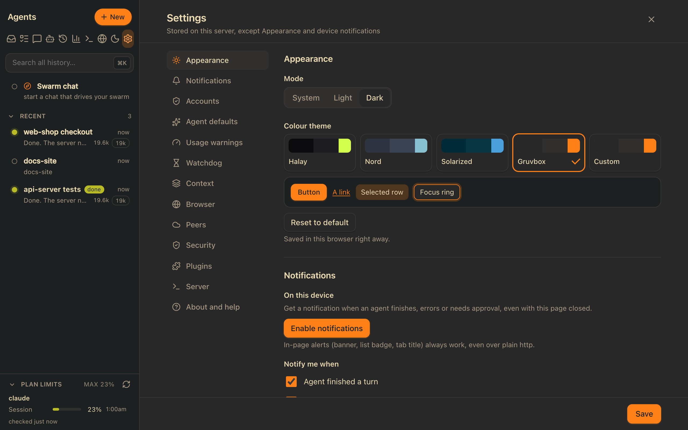
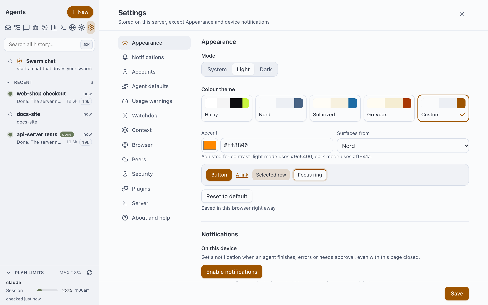

# Theming

The brand is the [halay.app](https://halay.app) palette: **ink** (`#0e0e11`) and **lime** (`#c9f53f`, `#d2ff4d` in dark mode), on neutral greys. Everything else is the status colours (green = ok, red = error, amber = warning). Status colours mean "something happened", so keep them apart from the brand colours.

Lime on a light background is only 1.3:1, so it can't be text, a link or a focus ring there. The default colour theme, **Halay**, does what the site does:

- **Light:** ink is the accent (primary buttons, links, focus, the running spinner). Lime is the highlight: the text on ink buttons, and the soft tint for selection, selected rows, chips and the focus halo, always with ink text on it. Call-to-action banners are solid lime with ink text in both modes.
- **Dark:** lime is the accent, with ink text on lime fills.

Users can pick another theme in Settings → Appearance (see [Colour themes](#colour-themes) below); this page first describes the tokens every theme sets.

## Where the colours live

- **`public/css/theme.css`**: its first lines set the default palette (Halay) for when scripts don't run: the light block `:root`, and the dark blocks (`@media (prefers-color-scheme: dark)` for "System" and `:root[data-theme=dark]` for a forced "Dark" in Settings → Appearance). The two dark blocks must stay identical. With scripts on, `js/theme.js` sets the chosen preset's tokens inline on `<html>`.
  - `--acc`: the accent. Used for primary buttons, links, focus rings, the running spinner, the "needs you" status and the permission card border. Light `#0e0e11` (ink), dark `#d2ff4d` (lime).
  - `--acc-rgb`: the same colour as `r,g,b`, for `rgba(var(--acc-rgb), .35)` shadows and tints. Keep it in step with `--acc`.
  - `--acc-s`: the soft tint (selection, selected rows, chips like the active tool tab and bot badges, the focus halo). Usually the accent at 16% (light) / 22% (dark); a preset can give it its own hue (`hl`, Halay light uses lime at 70%) or strength (`tint`, Solarized dark keeps 16% so its base1 text stays readable).
  - `--acc-t`, `--mut-t`: accent-coloured and muted text on the tint (active tab, bot badge; descriptions in a selected row). Derived per variant: the accent / muted colour moved the smallest step that reaches 4.5:1 on the tint, so the tint can be strong without costing legibility. Tinted rows set `--mut:var(--mut-t)`, so everything muted inside follows.
  - `--on-acc`: text and icons on an `--acc` fill. Halay: light `#c9f53f` (lime on ink), dark `#0e0e11` (ink on lime).
  - `--acc-h`: the hover fill for primary buttons, derived from `--acc` (a step lighter for a near-black accent like ink).
- `--cta`, `--on-cta`: an optional solid fill for call-to-action banners (Enable notifications) and the text on it. Halay sets lime in both modes, like the site's lime buttons; the other presets use their accent, with the button text colour on it. A variant without one (token `cta`) falls back to the soft tint.
- `--syn-kw`, `--syn-fn`, `--syn-str`, `--syn-num`, `--syn-type`, `--syn-com`, `--syn-tag`: code highlighting (keyword, function, string, number/attribute, type/built-in, comment, tag) from the preset's own syntax scheme (token `syn`). `theme.js` sets `data-syn` on `<html>` when the variant has them, and `css/viewer.css` maps highlight.js's classes onto them; without `syn` (Halay, a neutral theme) code keeps highlight.js's GitHub colours.
- `--ok`, `--err`, `--warn`: status fills (dots, pills, badges, danger buttons). `--on-st`: text on a status fill (white in the default theme; dark text in the dark variants of the lighter-surfaced presets, whose status colours are bright).
- Other stylesheets and scripts use only these variables. Never paste a hex value or `rgba(…)` copy of the accent anywhere else. `public/js/terminal.js`, for example, reads `--acc` and `--acc-rgb` for the cursor and selection colours.
- **`src/product.js`** holds the colours needed outside the CSS. They must equal the Halay theme values:
  - `BRAND_COLOR` (= light `--acc`, ink `#0e0e11`), the icon square.
  - `BRAND_LIME` (= the light highlight, `#c9f53f`), the lead circle in the icon.
  - `BRAND_SURFACE` (= dark `--bg`, `#0b0b0e`), used for the web app manifest's `theme_color` and `background_color`.
- **`public/js/theme.js`** applies the mode and the colour theme (below) and sets `<meta name="theme-color">` to the page background of the current theme.

## Contrast (WCAG AA)

Halay, the default:

- Light, ink text and links on the white, side, card and user-bubble surfaces: 19.3, 18.5, 17.5, 16.8:1; muted `#55555d`: 6.7 to 7.4:1
- Light, lime text on ink buttons: 15.3:1 (10.4:1 on the hover fill)
- Light, ink text on the lime tint (selection, selected rows, chips): 16.2:1 on the page, 15.9:1 on the sidebar; muted text on it 6.2:1
- Dark, lime `#d2ff4d` text on `#0b0b0e`, `#131317`, `#1b1b20`, `#222228`: 17.0, 16.0, 14.8, 13.7:1; body text 14.4 to 17.9:1
- Dark, ink on lime buttons: 16.7:1; lime text on its own tint: 9.5 to 11.6:1
- Ink on the lime call-to-action banner: 15.3:1 light, 16.7:1 dark
- For reference: lime on white is 1.26:1, which is why light mode doesn't use it as the accent.

`node test/theme-unit.mjs --report` checks every preset and variant and prints the ratios:

- 4.5:1 for body and muted text on the page, sidebar and card surfaces
- 4.5:1 for the accent as text/link on every surface, and for `--on-acc` on the accent and its hover
- 4.5:1 for body text on the soft tint (selected rows, chips)
- 4.5:1 for `--on-st` on the status fills, and 3:1 for the status colours against the surfaces (dots, icons, borders)
- the accent doubles as the focus ring and border colour, so its 4.5:1 covers the 3:1 needed there
- for Halay also: accent text on the tint, ink on a solid lime fill, the muted badge (page colour on `--mut`)

In light mode the ink accent is the body text colour, so the accent can't be the only signal:

- Chat links stay underlined.
- Status uses shape as well as colour (spinner = running, filled "!" = needs you).
- Selected and active things get the lime tint, not another text colour.

## Colour themes

Settings → Appearance → Colour theme lists the presets as cards (a radio group: arrow keys move and select, Home/End jump), then **Custom**. Picking one applies it at once; there is no Save. A preview strip below shows a button, a link, a selected row and a focus ring in the current colours.

### The presets

Halay (the default), Nord, Solarized and Gruvbox. Each has a light and a dark variant, so the System / Light / Dark switch works with all of them. The three palette themes are meant to feel like their editor themes, not a recoloured template: accent, status colours, code colours and banner all come from the palette.

- **Halay**: the halay.app palette, described at the top of this page.
- **Nord**: Polar Night dark, Frost accent; light is a near-white page with Snow Storm in the sidebar and cards.
- **Solarized**: dark is base03; light is a near-white warm page with base3/base2 in the sidebar and cards; blue accent.
- **Gruvbox**: light and dark, with Gruvbox's signature orange as the accent (`#a83802` / `#fe8019`); the light warning colour is its yellow so it stays apart from the accent.

They are data in **one** place, `public/js/themes.js` (`THEME_PRESETS`): per preset an `id`, a `name`, and `light` / `dark` objects with the tokens `bg side card ubg line fg mut acc onAcc ok err warn onSt`, and optionally `hl` (a highlight hue for the soft tint, see `--acc-s`), `tint` (its strength), `cta` (the call-to-action fill, see `--cta`) and `syn` (code colours, see `--syn-*`). `public/js/colors.js` derives the rest (`--acc-rgb`, `--acc-s`, `--acc-t`, `--mut-t`, `--acc-h`). Applying a theme sets these as inline custom properties on `<html>`, so there is no per-preset CSS. `theme.css` keeps the Halay palette as the fallback for when scripts don't run; `test/theme-unit.mjs` checks that it matches the first preset.

The canonical palette hex values are used wherever they reach WCAG AA. Where one didn't, it was moved the smallest step that passes, and a comment in `themes.js` gives the original (for example Nord's Frost `#5e81ac` → `#486384` in light mode). Status colours come from the palette where they pass with their text colour and against the surfaces; otherwise they are the palette's colour moved to pass (Nord light's Aurora, Solarized light's green). Only Halay uses the app's own (`#15803d`, `#dc2626`, `#b45309`); the unit test checks the palette themes don't. Code colours are the palette's syntax colours, moved where needed to reach 4.5:1 on the page and on code blocks.

### Adding a preset

1. Add an entry to `THEME_PRESETS` in `public/js/themes.js` with both variants and every token, including `cta`, its own status colours and `syn` from the palette's syntax scheme.
2. Run `node test/theme-unit.mjs --report`: it checks every variant against AA and prints the ratios. Fix failures by nudging the value (comment the original).
3. Add its id to the list in `test/theme-unit.mjs` and to `ids` in `bin/make-screenshots.mjs`, then look at it: `node bin/make-screenshots.mjs /tmp/shots themes` takes every preset, light and dark, at 1280px and 390px.

### Custom

**Custom** keeps the surfaces of a base preset ("Surfaces from", by default the last preset picked) and changes only the accent: pick a colour or type a hex value (`#36c` or `#3366cc`; anything else is flagged and not applied). From that one colour `js/colors.js` derives, per mode:

- the accent itself, darkened (light mode) or lightened (dark mode) in small steps until it reaches 4.5:1 against every surface and its text colour. A hint under the picker says when and to what it was adjusted.
- `--on-acc`: white or near-black, whichever contrasts more
- `--acc-h` (hover: a step away from the text colour), `--acc-rgb` and `--acc-s`

**Reset to default** returns to Halay and forgets the custom colour.

### Where it is stored

Per browser, in `localStorage`:

- `halay-theme`: the mode (`system`, `light`, `dark`)
- `halay-palette`: `{ preset, base, accent }`, for example `{"preset":"custom","base":"nord","accent":"#ff8800"}`. Missing means the default (whatever it is in this version); only **Reset to default** removes it. Picking a preset, the default included, saves it, so a later change of the default leaves that choice alone.

When Halay replaced Ink navy as the default, nothing had to be migrated: browsers with no saved palette show Halay, and any saved choice stays. Later some presets were removed: Ink navy (Halay without the lime), and Dracula and Catppuccin (their filled violet buttons read as a generic generated UI; Custom still gives a purple accent to whoever wants one). A saved `ink`, `dracula` or `catppuccin` falls back to the default, like any unknown preset.

`colors.js`, `themes.js` and `theme.js` load in `<head>` before the stylesheets, so the saved theme is on `<html>` before the first paint (no flash of the default colours). The login page loads the same three scripts, so it shows the saved theme before sign-in. `theme.js` re-applies on a mode change (the switch, or the system scheme under System) and when another tab changes either key; it fires a `halay:theme` event that the editor and terminal use to follow along. The web app manifest stays static (Halay, `BRAND_SURFACE`), since it can't follow a runtime choice.

## Changing the default theme

1. Edit the first preset in `public/js/themes.js` and the same values in all three palette blocks of `public/css/theme.css` (`test/theme-unit.mjs` checks they match).
2. Set `BRAND_COLOR`, `BRAND_LIME` and `BRAND_SURFACE` in `src/product.js` (light accent, highlight, dark page background).
3. Regenerate the icons: `node bin/make-icons.mjs`
4. Re-take the README screenshots and animations: `node bin/make-screenshots.mjs`, then `node bin/make-demos.mjs`

## Icons

`bin/make-icons.mjs` draws the halay mark (the halay.app favicon: an ink rounded square, a lime arc and lead circle, three light circles, on a 64×64 grid) from the `src/product.js` colours and writes:

- `public/favicon.svg` (the same file as the site's) and `public/favicon-32.png` (PNG fallback)
- `public/apple-touch-icon.png` (180px, full-bleed square: iOS rounds the corners)
- `public/icon-192.png`, `public/icon-512.png` (manifest, purpose `any`: rounded square, transparent corners)
- `public/icon-maskable-192.png`, `public/icon-maskable-512.png` (purpose `maskable`: full-bleed ink, the mark scaled to 80% so its farthest point is 36% from the centre, inside the 40% safe-zone circle)
- `public/badge-96.png` (Android notification badge for the service worker: the mark in white on transparent, since Android uses only the alpha)

It renders with `playwright-core` and the installed Google Chrome, drawing on a canvas, so the same input gives byte-identical PNGs. Commit the regenerated files.

## Screenshots

`bin/make-screenshots.mjs` starts a throwaway instance with demo agents and takes the README shots: desktop 1280×800 and phone 375×812, at 2× scale. The instance has:

- its own port, database, HOME, data folder and TMPDIR, all under `/tmp/demo` (`bin/demo-instance.mjs`, shared by both scripts)
- a clean environment: nothing from your shell (public URL, accounts, tokens) is passed on, and only `node` and the demo CLI are on its `PATH`
- the demo CLI from `test/fake-claude-demo` (no model calls)
- the Machines plugin switched off, so no host names appear in the shots
- demo project folders in `/tmp/demo-projects`, removed afterwards

`node bin/make-screenshots.mjs <dir> review` adds extra shots for checking a palette change: a 390px phone, dark welcome, a permission card and dialogs.

`node bin/make-screenshots.mjs <dir> themes` takes every colour theme preset in light and dark (chat at 1280px and 390px, and Settings), plus Custom. The default run also takes `docs/screenshots/settings-themes-dark.png` (Gruvbox, dark) and `settings-custom-accent.png` (Custom `#ff8800` on Nord, light), which this page shows.

`node bin/make-demos.mjs [dir] [name...]` records the README's animated demos (`demo-swarm-chat`, `demo-approval`, `demo-phone`, `demo-themes`; default: all) on the same kind of instance, with `DEMO_SCENES=1` so the demo CLI plays scripted, paced turns: the Swarm chat starts three agents through the swarm MCP server, and one of them asks for an approval through the real approval path. Frames come from Chrome's screencast and become a GIF (ffmpeg palettegen/paletteuse; about 960px wide, 390px for the phone) and an MP4 next to it. It needs `ffmpeg` (`FFMPEG=` picks the binary); `KEEP_FRAMES=1` keeps the raw frames for checking. Look through the frames before committing: nothing from your machine should appear.
